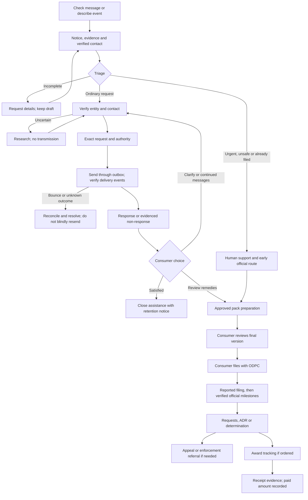

# Refined consumer journey and operations workflow

All flows here are proposed requirements. No backend behaviour is implemented by these documents or mockups. PG IDs refer to baseline features; A IDs are additions in the [alignment matrix](06_FEATURE_ALIGNMENT.csv).

## Consumer journey

1. **Understand the offer.** One primary action, “Check a message”. Show independence from ODPC, optional assistance cost range and a free self-service link. Do not require legal vocabulary, an account or a payment to read guidance. Let the user describe a phone call or missing screenshot.
2. **Choose evidence, with a short privacy notice first.** “Only share this message. Hide unrelated names, numbers and ID details.” Offer preview, crop/redact and remove. Originals containing necessary evidence need restricted handling; redaction does not mean the original was never processed. A description-only report remains “needs evidence”, not “verified”.
3. **Save with one verified contact method.** Verify email or phone when saving real evidence to an account or requesting staff work; do not demand both. Explain OTP expiry/resend limits and provide an accessible recovery route. An OTP verifies present control, not historic ownership, sender authenticity or identity. Avoid server persistence of raw evidence before a clear privacy notice and defensible account/session boundary.
4. **Ask the minimum context.** Sender/brand if known, received date or “not sure”, whether previously asked to stop, and desired outcome. Allow “stop messages”, “understand use of my data”, “both” or “help choosing”. Do not preselect a broader request. Collect detailed harm only if the consumer wants remedy review; do not coach an inflated claim.
5. **Triage and show a real next step.** Automate completeness, duplicate hints and company candidates. Staff resolve uncertain attribution, suspicious evidence and urgent circumstances. Missing evidence triggers a specific request with an owner and due date; it does not become a fraud allegation. Consumers can continue free self-service or choose a clearly priced, suitable service.
6. **Company contact if appropriate.** Show exact legal entity, verified destination, request type, letter version and attachments. Explain what information will be shared. Obtain explicit, unselected authority for this case and this transmission. Changed recipient, letter or attachments invalidates the prior approval. Publish queued/accepted/bounced states accurately.
7. **Wait with useful information.** Show the right requested, request date, receipt/service evidence, legal deadline where verified, and next follow-up. “No reply yet” is neutral. A reminder is not an ODPC submission. Consumer can add new messages, revoke unsent authority or ask for early regulator guidance.
8. **Read the actual company response.** Present “The company says…” separately from reviewer notes and the consumer's experience. No closure choice preselected. Options: satisfied/stop assistance; still receiving marketing; need clarification; review past conduct/remedies. Company consent evidence can resolve one issue without defeating a later objection.
9. **Choose a regulator branch when wanted.** Explain filing is free and possible outcomes without payout estimates. Prepare a dated, versioned pack only on instruction, preserving unresolved facts and adverse evidence. Review the completed pack and corrections; preparation authority is not authority to submit. Earlier packs may organise evidence before any company exchange; label what is missing.
10. **File independently through an official channel.** Provide a direct portal link and field-by-field guide, without collecting ODPC OTP, password or routine ID scans. Link opening means “portal opened”, not “filed”. If portal access fails, show confirmed alternate official options/support. Do not scrape or submit automatically.
11. **Track verified milestones.** Consumer can report filing and supply a redacted receipt; staff verify correspondence before acknowledgement/admission. Record information requests with a named owner and due date. Determination, appeal/stay and compensation paid remain separate. Late filings and uncertain references go to review, not success badges.
12. **Close the service deliberately.** State the reason, outstanding matters, what will be retained and when it will be reviewed. Closing PrivacyGuard assistance neither waives rights automatically nor withdraws an ODPC complaint. Provide download, privacy-request and reopen/new-incident routes. Settlement and official withdrawal require separate informed actions.

## Decision branches and closure rules

| Trigger | Recommended response | What must not happen |
|---|---|---|
| No screenshot / phone call | Accept factual description as incomplete; provide evidence options | Fabricated attachment, automatic rejection or “evidence verified” |
| Unknown or spoofed sender | Research candidates; ask for context; keep allegations neutral | Guess legal entity or privacy address from alias |
| Several companies/intermediaries | Model respondents separately under one private matter; scope one paid service per disclosed deliverable | Send all evidence to every possible company or silently multiply charges |
| Valid prior consent shown | Reviewer checks scope/date/channel, shows consumer evidence; process current objection separately | Automatic case dismissal or refusal to stop current marketing |
| Company says stopped | Ask consumer; preserve past-conduct question | Automatic closure or promise that stop equals no violation |
| No company response | Review service evidence and correct clock; offer next step | Treat silence as admission of liability or guaranteed award |
| Threats, safety risk, sensitive/minor facts or serious ongoing harm | Prompt human review and appropriate official support; bypass routine wait where justified | Force company contact or promise emergency response beyond staffing |
| Already filed / represented | Record current official reference and counsel involvement; avoid duplicate submission | Open a second regulator complaint without review |
| Settlement offered | Present terms and optional independent advice; record consumer decision separately | Auto-accept, negotiate legal rights without authority, or take custody of settlement funds |
| Authority withdrawn while queued | Cancel unsent action transactionally; reconcile in-flight dispatch | Claim already transmitted material has been recalled |
| Consumer inactive | Reminders subject to preferences, then pause service with notice; retain under approved policy | Auto-withdraw ODPC matter or silently erase evidence under an active hold |
| Determination or appeal | Preserve original order; lawyer reviews deadlines and consequences | Equate an award with money collected or invent appeal period |

## Operations: work items rather than a wall of cases

The main unit of work should be an **assigned task** tied to a case, reason, evidence and due date. A case can simultaneously await a company and need an operator to fix a bounced message. One global status cannot express this reliably.

Queue order: safety/incident triage → official requests and imminent deadlines → failed delivery → unassigned/evidence/identity exceptions → consumer questions → routine research. Show age, owner, next action, due-date source and last contact. Every dashboard count must link to its exact query/filter; closed or advanced cases must leave stale priority lists.

Proposed internal service targets, not statutory guarantees: acknowledge support within one staffed business day; assign ordinary exceptions within two; immediately alert duty staff to a security incident; route regulator deadlines with an earlier internal buffer. State staffed hours and emergency limitations honestly. Targets require funded staffing before public promises.

### Company contact engine

1. Gather brand, sender alias, links/domain and consumer context without trusting message links.
2. Identify the legal entity using official company material and, where justified, BRS records. ODPC registration listings may corroborate entity/role; they are not automatically a usable DPO directory.
3. Find a published privacy notice/DPO channel or confirmed registered-office route; no guessed firstname@domain addresses. Avoid automated requests to private/internal network addresses.
4. Save source URL/document, retrieval time, legal entity ID, domain evidence, reviewer, confidence and expiry. Store only necessary professional contact details and consider notice duties for named individuals.
5. Approve an independently verified contact. Revalidate when sources change, mail bounces or risk increases; suggested90-day review interval is an operational policy, not law. High-risk changes or domain mismatch need second review.
6. Reuse a verified directory entry, but freeze the destination/source snapshot for each authorised notice. A directory edit must not silently reroute an already approved request.

### Communication engine

Use opaque per-case reply aliases, not phone numbers or predictable case IDs. Authenticate provider webhooks using the provider's documented protocol, replay window and stored event IDs. Preserve original headers/body/attachments under appropriate access controls; scan attachments before staff preview. Strip active HTML, remote trackers and dangerous URLs from rendered email.

Match on validated reply tokens, message IDs and case context. A forwarded email or matching subject is a candidate, not proof. Quarantine unmatched, multi-case, spoofed or suspicious messages. SPF/DKIM/DMARC results are signals, not proof of the substantive claims. A legitimate company may forward mail; permit human reconciliation with an audit trail.

Commit approved request, immutable content and outbox event in one database transaction. Worker rechecks authority and version immediately before dispatch. Idempotency key includes case, recipient, purpose and document version. Provider acceptance is “sent/accepted by provider”; delivery is a separate event; read receipts are not assumed. On timeout after possible send, reconcile provider state before retrying. Bounces create a task; do not start a reliable recipient-receipt clock from failed delivery. Suppress duplicate incoming provider events.

### Deadline engine

Each obligation has right/type, source/provision/version, start-event ID, start timestamp, calendar rule, timezone, due date, uncertainty, owner and reviewer. Preserve history if a trigger is corrected. Store instants in UTC and render Kenya time. Distinguish calendar days, working days, public holidays, internal targets and case-specific official directions. Avoid assuming a delivery callback legally proves service.

Never reset an access deadline when an objection is added. Never start a legal clock when a draft is created. Conflicting rules or uncertain service generate review tasks. Update rule versions prospectively and identify affected open cases; no silent retroactive changes.

### ODPC work and financial outcomes

An official record includes artifact, source channel, received date, reference, milestone, verifier and applicable due date. Acknowledgement alone is not a merits decision. Information-request responses require preparation, accuracy approval, lawful authority, dispatch evidence and confirmation where available. Track ADR, withdrawal, discontinued, dismissed, corrective action and award distinctly.

For an award, preserve ordered amount/currency/date, payment deadline if stated, appeal/stay, any varied order, receipts and outstanding amount. Payment received is evidence-backed and can be partial. Initial scope is tracking and referral, not court enforcement, debt collection, escrow or custody. Any expansion needs separate legal/product approval.

## Automation boundary

| A: deterministic automation | B: automation prepares; human approves | C: human/legal decision |
|---|---|---|
| Private case IDs, upload receipts, hashes, scans, task creation, reminders, event deduplication, versioned template merge, approved dispatch, status projection, retention candidates | OCR, sender candidates, contact research, evidence inconsistencies, reply classification, draft summaries, pack chronology, official milestone extraction | Attribution disputes, fraud allegations, legal merits, ambiguous consent, settlement/waiver, professional advice, appeal/enforcement, contested deletion/holds |

Deterministic actions still need correct inputs and safeguards. No AI in initial release unless a measured benefit justifies transfer/cost/evaluation work. If added later, treat uploaded documents and emails as untrusted data, never instructions to tools; use constrained extraction with citations and human review. Do not let a model send, close, reject or change rights autonomously.
