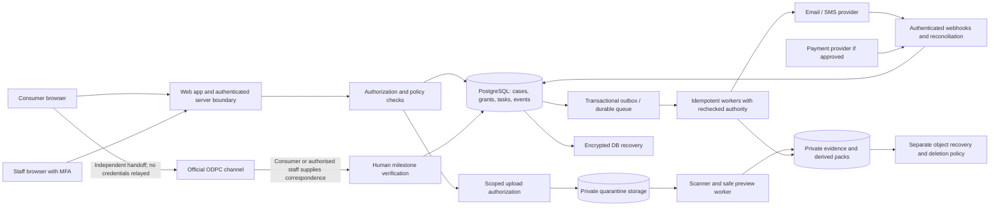

# Recommended architecture, privacy and evidence controls

**Design only.** No schema, application, policy or external integration has been deployed. All acceptance requirements below are future release gates. Technology choice does not establish legal compliance.

## Architecture decision

Keep a modular monolith: Next.js/React/TypeScript for the application, PostgreSQL as the system of record, Supabase Auth, carefully scoped server actions/API endpoints, private object storage, a transactional outbox and durable jobs. Tailwind/shadcn may help consistency but require accessibility verification. Server-render public content and progressively load case features; avoid shipping operations screens to anonymous/mobile visitors.

**Provisionally prefer Supabase Storage instead of introducing R2 immediately**, subject to transfer assessment and recovery capability. It reduces separate authorization and deletion surfaces. If processor/location review rejects it, consider an evaluated Kenya-hosted managed PostgreSQL/object-storage provider; do not choose an unassessed local vendor solely for a Kenya address. R2 remains an alternative for measured storage/egress needs, not a compulsory architectural component.

Supabase's inspected region list did not include Kenya/Africa. EU/US placement and a marketing claim of encryption are not transfer approval. R2 location hints do not guarantee location; jurisdiction restrictions are a different feature. Neither service by itself solves Kenyan transfer obligations. [Supabase regions](https://supabase.com/docs/guides/platform/regions), [R2 location controls](https://developers.cloudflare.com/r2/reference/data-location/)

### Trust boundaries

Consumers cannot choose owner IDs, staff roles, legal status or verified milestones. Staff actions require server-side authorisation and current case scope. Email and regulator attachments enter as untrusted content. Signed storage links are bearer access: short-lived, one-object scoped, no public listing, no sensitive names in keys. External handoff uses an allowlisted official URL but does not imply an integration.

Do not expose Supabase secret/service-role credentials in the browser. RLS must cover every relevant table, join/view, function and storage-object access. A server service-role operation must still check actor and case scope before using elevated credentials. Prefer security-invoker views or equivalent restricted access; constrain security-definer functions/search paths. User-editable metadata is not a role authority. Recheck staff suspension/role changes rather than relying indefinitely on stale JWT claims. [Supabase RLS documentation](https://supabase.com/docs/guides/database/postgres/row-level-security)

## Data model and state invariants

| Module | Proposed entities | Important invariant |
|---|---|---|
| Identity | accounts, verified_contacts, staff_memberships, sessions/recovery_events | Current contact control is not identity/history proof; consumers never grant themselves staff access. |
| Cases | cases, case_parties, case_members, goals, incidents | One private matter can have several separately scoped respondents; no cross-consumer grouping in MVP. |
| Evidence | evidence_objects, versions, transformations, scan_results, provenance | Received bytes, scan status and reviewer opinion are distinct; unsafe files never become shareable by a UI flag. |
| Directory | legal_entities, brands, sender_aliases, contacts, contact_sources, verification_reviews | Identity and mailbox verification separate; sent notice keeps the frozen destination/source snapshot. |
| Authority | processing_notices, lawful_basis_records, action_grants, withdrawals | Grant binds actor+case+purpose+recipient+document/attachment version; mutation invalidates grant. |
| Requests | rights_requests, request_versions, dispatches, deliveries, correspondence, message_matches | Draft ≠ queued ≠ provider accepted ≠ delivered ≠ read; no automatic inference from case status. |
| Work | tasks, assignments, obligations, deadline_rules, deadline_revisions | Each actionable exception has owner and due basis; case may have multiple concurrent tasks. |
| Regulator | packs, pack_items, filing_reports, official_artifacts, milestones, information_requests, decisions, appeals, settlements | User-reported reference stays unverified until evidence review; determination/award/payment separate. |
| Finance | orders, payment_attempts, provider_events, refunds, award_receipts | Service-payment ledger separate from compensation tracking; duplicate callbacks cannot duplicate fulfilment. |
| Governance | audit_events, privacy_requests, holds, retention_actions, incidents, processor_register | Holds have lawful reason/expiry review; audit access is controlled and audit records do not duplicate whole evidence bodies. |

Use explicit transition guards in transactions, optimistic version checks, unique constraints and append-only audit events. This does not require a fully event-sourced application. Maintain relational current state plus immutable event/version records and rebuildable projections.

Recommended separate state axes:

- **Case service:** draft → triage → active / paused → closed; reopening records a reason/new incident.
- **Evidence:** pending upload → quarantined → clean / rejected / needs review → reviewed sufficient / insufficient.
- **Request:** draft → awaiting authority → authorised → queued → accepted / uncertain / failed → delivered if evidenced → replied / overdue / withdrawn before dispatch.
- **Regulator:** not pursued → preparing → pack reviewed → filing reported → receipt verified → acknowledged/admitted as evidenced → information/ADR/investigation → determined/discontinued/withdrawn; appeal/stay is a linked track.
- **Award:** not ordered → ordered → stayed/varied where applicable → partially paid / paid / outstanding, based on receipts and operative order.

Do not overwrite history when evidence changes or an appeal reverses a decision. “Closed” is not a shortcut for “reply received”. Consumer display is a projection of verified facts with one next action, never a percentage of a regulator investigation.

## Reliable automation

Store the business transition and outbox message atomically. Worker reserves jobs, renews visibility when needed, retries with bounded exponential backoff/jitter, and moves persistent failures to a dead-letter queue with an assigned operator. Use per-provider rate limits and fairness so one large respondent cannot starve urgent official work. Scheduled sweepers detect missing tasks and stuck jobs.

Supabase queue visibility semantics do not guarantee one external effect forever. A worker can send an email and crash before acknowledging the job. Use provider idempotency where supported, dispatch ledgers, unique business keys and reconciliation for ambiguous outcomes. Do not blindly retry an unknown payment or notice. [Supabase queue documentation](https://supabase.com/docs/guides/queues/pgmq)

Recheck active authority, contact version, evidence suitability and case lock immediately before a dispatch. Withdrawal racing with a send must result in a truthful state: cancelled if unsent, or already dispatched with time/evidence if sent. No system can promise to revoke a delivered email.

For payments, use an authenticated server initiation, trusted merchant/order/amount mapping, unique provider reference, callback replay protection and provider status reconciliation under the exact Daraja product specification. Never trust a client success screen, pasted M-Pesa SMS or unverified callback alone. Do not invent callback signatures: use documented controls for the chosen product and reconcile uncertain outcomes. PINs remain with the provider. [Safaricom transaction status](https://developer.safaricom.co.ke/apis/TransactionStatus)

## Privacy architecture

Likely PrivacyGuard is a controller for its own service purposes; vendors may be processors, and respondents/ODPC have separate roles. Contract labels alone do not decide roles. A Kenyan privacy lead/counsel must approve the actual processing map, third-party/sensitive-data conditions and transfer mechanisms.

| Purpose | Proposed basis/authority analysis, requiring review | Minimisation |
|---|---|---|
| Deliver requested free/paid assistance | Consider contractual necessity where applicable; explain accurately, do not demand artificial blanket consent | One contact channel and necessary case facts |
| Send specific company communication | Underlying processing basis plus separately recorded consumer mandate | Exact approved recipients and attachments only |
| Organise pack | Consumer instruction and appropriate service basis; no implied filing authority | Relevant evidence and factual narrative |
| Security/fraud prevention | Assess legitimate interests and proportionality, with human contest route | Short-lived rate signals; no expansive fingerprinting by default |
| Legal retention/finance | Applicable obligation or documented claims need | Minimal ledger/grant proof rather than entire case forever |
| Marketing the PrivacyGuard service | Separate optional choice and applicable marketing rules | No repurposing case evidence or contact lists |

The no-ID strategy reduces intentional collection, but users may upload an ID image accidentally or correspondents may attach one. Say **“We do not ask for ID photos. If the official channel asks, provide them there.”** Add warnings and client-side preview/redaction before upload, plus server quarantine and a deletion/escalation procedure. A classifier cannot guarantee no sensitive content ever enters storage. Do not claim “never enters” in production without defining and testing the actual boundary.

### Retention proposal — values require approval

These are design hypotheses, **not statutory periods**. Counsel must reconcile necessity, disputes, tax duties, appeal/enforcement and applicable limitation rules before production.

| Class | Proposed default to assess | Holds, deletion and user visibility |
|---|---|---|
| Unsaved local draft | Session only, optional explicit device save | Warn shared-device users; no hidden server copy |
| Abandoned authenticated draft |30days since last activity, warning before expiry | Extend on request where justified; no indefinite default |
| Rejected/accidental ID upload | Quarantine with prompt review; delete unnecessary bytes as soon as safely possible | Minimal incident/action record, no “preserve originals” excuse for unnecessary ID |
| Active evidence/correspondence | While necessary for active service and documented legal purpose | Restricted original and shareable derivative; reviewer can restrict scope |
| Closed case evidence | Review at90days, propose deletion by180days unless justified | Consumer export, advance notice, documented extension/hold with periodic review |
| Authority and minimal action proof | Duration matched to actual liability/claims need | Approve separately; does not justify retaining all attachments |
| Security logs | Proposed90days with shorter raw network-data retention | No message bodies, ID images, secrets or signed URLs |
| Finance records | Applicable accountant/counsel-approved statutory schedule | Separate from evidence; redact unrelated complaint data |
| Backups | Defined rolling window, e.g.30days if chosen recovery tier supports it | Deletion recorded as tombstones and replayed after restore; no immediate-backup-erasure claim |

Privacy requests need a queue, identity-proportionate verification, scope, statutory deadline, response and appeal/complaint information where appropriate. Separate revoke-unsent-authority, stop service, withdraw consent, delete data and close account. Never suggest one toggle automatically deletes ODPC/company-held data. Legal holds require authority, reason, scope, periodic review and release; staff cannot add indefinite holds to avoid work.

### Security and recovery

- Staff MFA, least privilege, case assignment, access review, immediate offboarding; sensitive exports/contact changes/refunds require stronger checks or second approval. Consumer recovery must address recycled SIM/shared email without asking for unnecessary ID by default.
- Private storage, TLS, provider encryption, separate keys/secrets and rotation. Assess additional application encryption only for a defined threat model; avoid claiming it protects data while an authorised compromised app decrypts it.
- Upload limits, MIME sniffing, malware scanning, decompression limits, isolated PDF/image rendering, safe filenames and quarantine. Reject active content; never execute uploaded documents or follow embedded instructions.
- Server authorization, RLS/IDOR tests, CSRF/session protections, rate limiting, CSP, dependency/security checks, restricted administrative interfaces and no production data in development.
- Audit staff reads/downloads as well as mutations; detect bulk access and require reasons for exceptional access. Do not advertise log immutability if privileged actors can rewrite the same store; consider restricted external audit retention later.
- Incident exercise covers wrong recipient, compromised mailbox, lost staff device and exposed signed URL. Assess breach obligations from awareness, not delayed forensic certainty.

Supabase database backups exclude object bytes. A restore plan must recover database and objects consistently, including version mapping and deletion/hold records. Define pilot targets **RPO≤24h/RTO≤8h**, improve to **RPO≤1h/RTO≤4h** only after funded architecture and measured drills. These are proposed targets, not provider guarantees. PITR alone does not recover deleted evidence objects. [Backup documentation](https://supabase.com/docs/guides/platform/backups)

Use encrypted backup credentials separate from application credentials, restricted restore environment, scheduled restore drills and checksums/reconciliation. Replay deletion tombstones before reopening restored data. Preserve the ability to export PostgreSQL, object inventory and metadata to reduce lock-in. Document incident communications if recovery exceeds targets.

## Proportionate fraud strategy

| Threat | MVP controls | Limit / fair treatment |
|---|---|---|
| Fabricated/edited screenshot | Preserve necessary source, hash on receipt, provenance questions, compare chronology and requested originals where feasible | Hash proves unchanged bytes after receipt, not truthful content; metadata may legitimately be absent |
| Reused evidence/duplicate accounts | Same-account duplicates, controlled cross-case duplicate signals, rate limits and human review | No disclosure that another consumer filed; shared household/device is not fraud |
| Impersonated number | OTP on relevant channel where feasible; date/context and historic-control questions when material | OTP now cannot prove control when message arrived; allow recycled-number explanation |
| Spoofed company/sender | Separate alias, brand and legal entity; verified official-source contact | Sender ID alone insufficient; uncertain attribution pauses sending |
| Altered reply/regulator reference | Original message/header or official artifact, source verification and case match | Forwarded mail and handwritten reference remain unverified claims |
| Inflated harm | Open factual prompts, evidence and human/legal review | No compensation calculator or coached narrative; incomplete proof is not an accusation |
| Automated mass submissions | Quotas, abuse throttling, accessible challenge alternatives, anomaly review | Do not suppress legitimate repeated marketing complaints solely for volume |
| Insider misuse | Scoped access, read/export logs, review, separation of finance and adjudication | Audit sampling and sanctions process needed beyond technical logs |

Later options: measured OCR/metadata assistance, better entity matching and provider-confirmed evidence channels if lawful/available. Avoid invasive device scanning, address-book uploads, inbox crawling, biometric identity or automated fraud verdicts. Provide an appeal/recheck path for adverse screening.

## Scale and observability

At100–1,000monthly reports, one application deployment and a small durable worker are sufficient design candidates; benchmark before promising capacity. At10,000, optimise indexed queue queries, bounded file processing, connection pooling, partition large audit data only if measured and separate worker capacity. At100,000, load-test peak bursts, active-case backlog, provider rate limits, storage lifecycle and recovery; add read replicas/partitioning only where evidence supports them. Do not infer throughput from MAU allowances.

Monitor queue age, unknown send outcomes, bounce rate, webhook lag, official deadlines, unauthorised access attempts, scan latency, object/database mismatch, per-case labour, refund rates and restoration results. Logs use opaque IDs; alert payloads contain no complaint content. Define an on-call owner and runbooks before promising monitored deadlines.
